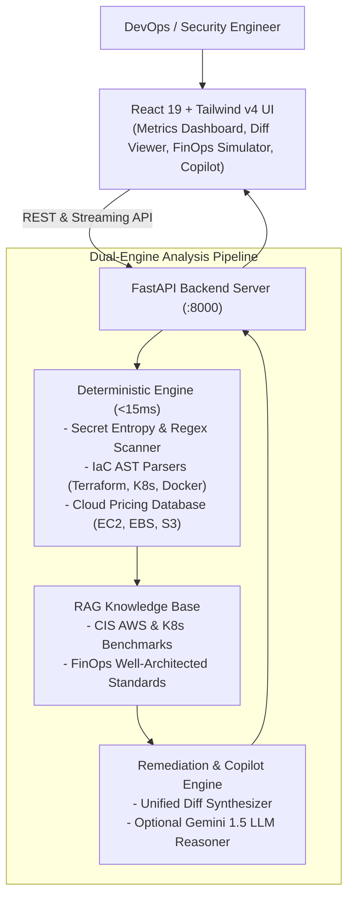

# 🛡️ CloudSentinel AI — Autonomous Cloud Cost & DevSecOps Intelligence Engine

[](https://fastapi.tiangolo.com)
[](https://react.dev)
[](https://tailwindcss.com)
[](https://python.org)
[](https://www.cisecurity.org/)
[](https://www.finops.org/)

> **An enterprise-grade DevSecOps and FinOps intelligence platform that continuously analyzes Infrastructure-as-Code (Terraform, Kubernetes, Docker) to eliminate security vulnerabilities, detect leaked secrets, and recover thousands of dollars in wasted cloud spend.**

---

## 💡 The Real-World Problem It Solves

Modern cloud engineering teams grapple with two major problems:
1. **Cloud Sprawl & Hidden Billing Waste (FinOps)**: Development environments regularly leave oversized instances running (`m5.4xlarge`), unattached EBS volumes, legacy `gp2` disks, and uncompressed S3 buckets without lifecycle policies. Engineering budgets bleed thousands of dollars every single month.
2. **Infrastructure Misconfigurations & Exposed Secrets (DevSecOps)**: Developers commit Terraform and Kubernetes configs with permissive security groups (`0.0.0.0/0` SSH access), privileged container roots, and hardcoded API keys.
3. **The Actionability Gap**: Traditional scanners dump overwhelming walls of warnings that nobody has the time to resolve manually.

**CloudSentinel AI** bridges this gap: it combines **deterministic AST rule scanning** with **LLM reasoning** to generate **instant, unified Git diff patches** that engineers can preview, apply in 1 click, or submit as GitHub PRs.

---

## 🚀 Key Features & Highlights

- ⚡ **Zero-Latency Deterministic AST Engine**: Rapid static analysis (< 15ms) across Terraform (`.tf`), Kubernetes (`.yaml`), Dockerfiles, and `.env` configs.
- 💰 **FinOps Waste Detection & Rightsizing**:
  - Automatically identifies overprovisioned x86 compute and models immediate 60-80% savings by switching to AWS Graviton (`t4g`/`c6g`).
  - Flags legacy `gp2` volumes and auto-upgrades them to `gp3` (20% savings + 3x baseline IOPS).
  - Detects cold S3 buckets missing automated lifecycle tiering to Glacier.
- 🔐 **High-Entropy Secret Leak Detection**:
  - Catches hardcoded AWS Access Keys (`AKIA...`), GitHub PATs (`ghp_...`), JWT tokens, database passwords, and private RSA keys.
  - Automatically recommends parameter injection via AWS Secrets Manager or HashiCorp Vault.
- 🪄 **Autonomous 1-Click Git Diff Remediation**:
  - View syntax-highlighted unified diffs (`-` deletions and `+` additions).
  - Mutates code in memory to watch the security score jump from **Grade F to Grade A+** in real time!
- 📊 **Interactive FinOps Cost & ROI Simulator**:
  - Interactive sliders to model team instance counts, EBS storage volumes, and cold S3 archives.
  - Computes net annual budget savings and unoptimized vs optimized run-rates in real time.
- 🤖 **Context-Aware AI Copilot (RAG Grounded)**:
  - Chat with your infrastructure code.
  - Grounded in **CIS AWS Benchmark 1.4**, **CIS Kubernetes Benchmark 1.6**, and **FinOps Foundation best practices**.
  - Works 100% offline via bundled heuristic RAG or connects to Google Gemini for multi-turn LLM reasoning.
- 📑 **One-Click Executive Audit Export**:
  - Generates downloadable Markdown reports formatted for security leadership and compliance auditors.

---

## 🏗️ System Architecture



---

## 🛠️ Tech Stack Breakdown

| Layer | Technologies Used |
|---|---|
| **Frontend** | React 19, Vite, Tailwind CSS v4, Lucide Icons, Modern Glassmorphism UI |
| **Backend** | Python 3.14, FastAPI, Pydantic v2, Uvicorn, Python-dotenv |
| **AI / RAG** | Dual-mode: Local AST & Knowledge Base + Optional Gemini 1.5 Flash via HTTPX |
| **Compliance** | CIS AWS Foundations Benchmark v1.4, CIS Kubernetes Benchmark v1.6, CWE-798 |
| **Testing** | Python Unittest (100% pass on scanner, rules, and scoring pipelines) |

---

## ⚡ Quick Start Guide

### Prerequisites
- Python 3.10+ (Tested on Python 3.14)
- Node.js 18+ (Tested on Node v24)
- npm

### 1. Launch with One Click (Windows)
Double-click `start_dev.bat` or run in PowerShell:
```powershell
.\start_dev.ps1
```

### 2. Or Launch Manually in Two Terminals

#### Terminal 1 — Backend (FastAPI):
```bash
cd backend
# On Windows:
.\venv\Scripts\activate
# Install requirements if not already installed:
pip install -r requirements.txt
# Run FastAPI server:
uvicorn app.main:app --host 0.0.0.0 --port 8000 --reload
```
*API Swagger Documentation is available at: [http://localhost:8000/docs](http://localhost:8000/docs)*

#### Terminal 2 — Frontend (React):
```bash
cd frontend
npm install
npm run dev
```
*Open your browser at: [http://localhost:5173](http://localhost:5173)*

---

## 🧪 Running Unit Tests

Run the test suite from the root directory:
```bash
.\backend\venv\Scripts\python.exe -m unittest backend/tests/test_engine.py
```
Expected output:
```text
....
----------------------------------------------------------------------
Ran 4 tests in 0.002s

OK
```

---

## 📋 API Endpoints Reference

| Method | Endpoint | Description |
|---|---|---|
| `GET` | `/api/health` | Health check & loaded rules counter |
| `GET` | `/api/samples` | Lists bundled real-world enterprise scenarios |
| `POST` | `/api/scan` | Analyzes uploaded files or raw text payload |
| `POST` | `/api/remediate` | Generates unified git diff and PR content for a finding |
| `POST` | `/api/chat` | RAG-grounded copilot answering infra questions |
| `POST` | `/api/export-report` | Produces downloadable executive compliance audit report |

---

## 🎯 Portfolio Showcase Scenarios Included

CloudSentinel AI includes 3 pre-loaded real-world enterprise test scenarios accessible in 1 click:
1. **Enterprise AWS Cloud Sprawl & IaC Vulnerabilities**: Hardcoded AWS credentials, 0.0.0.0/0 SSH open to the internet, oversized `m5.4xlarge` EC2 instance, legacy `gp2` storage, and public S3 bucket without lifecycle tiering.
2. **Production Kubernetes Cluster Risks**: Root container execution (`runAsUser: 0`), privileged flag, 4000m excessive CPU reservations, and exposed JWT tokens in environment variables.
3. **Dockerfile Supply Chain & Leaked Credentials**: Mutable `:latest` tags, hardcoded GitHub tokens, and missing non-root USER directives.

---

## 📄 License
MIT License. Free to use, adapt, and showcase for educational and portfolio purposes.
